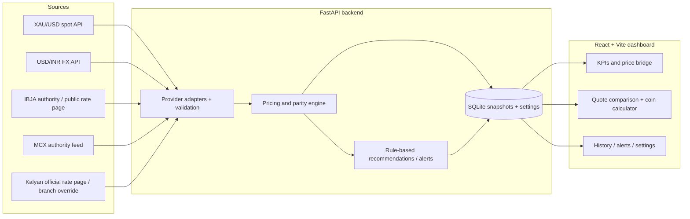

# Aurum / Gold Intelligence — India Gold Price Tracker

A full-stack, locally runnable gold-price dashboard built with **FastAPI + React + Vite + SQLite**. It connects global spot gold and FX to Indian benchmarks, compares IBJA/MCX/Kalyan references, estimates a 24K coin invoice, stores price observations, and produces transparent rule-based buying/negotiation suggestions.

> **Important:** this is a research and purchase-comparison tool, not a trading system or investment adviser. It does not execute orders. Provider data may be delayed or unavailable. The app explicitly labels source, status and timestamp; it does not fabricate missing live quotes.

## What is included

- XAU/USD spot price, USD/INR and derived unadjusted INR value for 999 gold.
- Configurable import-duty + domestic-premium model to estimate an India landed-parity reference.
- IBJA 999 benchmark and MCX authority feed when your Metals.Dev plan exposes those authority fields.
- Kalyan published 24K/22K rate parser plus best-effort public-page adapters for Tanishq, Malabar and Senco. Other retailers remain available for manual verified quotes. Website rates can be national/state/city scoped and retailer billing-time rates prevail.
- Kalyan-vs-IBJA premium, IBJA-vs-model spread, MCX-vs-IBJA basis and 22K/24K estimates.
- Physical coin invoice estimator (weight, coin premium, flat fees and GST are configurable).
- Rules-based signals: favourable published quote, fair/verify bill, negotiate/compare, or verify data.
- Manual verified quote overrides for IBJA, MCX, Kalyan, XAU/USD and USD/INR.
- SQLite price history and dashboard settings.
- 60-second refresh loop (configurable), responsive React dashboard and calculation tests.

## Architecture



## Data model and calculations

### 1. Global price conversion

`INR/gram (999) = XAU/USD per troy ounce × USD/INR ÷ 31.1034768`

### 2. Simplified India import-parity estimate

`Estimated 999 INR/10g = global spot INR/10g × (1 + import duty %) × (1 + domestic premium %) + local cost`

The default 15% import-duty setting reflects the effective 10% BCD + 5% AIDC rate reported as effective from 13 May 2026. It is editable and must be re-verified if law changes. This is a **simplified modelling assumption**, not a customs valuation calculation or official IBJA rate. Tariff values, importer hedging, local premiums, funding, freight, taxes and supply conditions can create a material difference.

### 3. Retail premium

`Kalyan premium vs IBJA (%) = (Kalyan 24K published rate ÷ IBJA 999 × 100) − 100`

### 4. Coin estimate

`Taxable value = metal value + coin premium + fixed fee`

`Estimated invoice = taxable value × (1 + GST %)`

The default 3% GST is an estimate; have the seller show the tax treatment and components on the invoice. GST calculation for retail jewellery/coins can depend on the transaction structure; do not use this as a tax opinion.

## Data-source hierarchy

| Metric | Primary | Fallback | Data quality note |
|---|---|---|---|
| XAU/USD | Metals.Dev spot endpoint | GoldAPI.io, then Twelve Data if configured | Market-data vendor feed; check its plan and latency |
| USD/INR | Metals.Dev currency endpoint | Twelve Data; otherwise open.er-api.com daily reference | The public fallback is daily, not live FX |
| IBJA 999 | Metals.Dev `authority=ibja` | Public IBJA webpage parser | Public scrape is a fallback, not an official licensed API |
| MCX gold | Metals.Dev `authority=mcx` | Manual override | Provider availability/contract basis depends on plan and feed schema |
| Retailer 22K/24K | Kalyan, Tanishq, Malabar and Senco official pages where current rows are parseable | Manual showroom quote for all listed retailers | Website scope, purity and timestamps differ; verify the exact branch quote |

Metals.Dev documentation states up to 60-second delay for spot/metal rates, up to 120 seconds for currency rates and up to 90 seconds for authority rates. It documents `lbma`, `mcx` and `ibja` authority identifiers. Check your subscription plan for endpoint access, request quota and licence rights before commercial use.

For banking, lending, audited valuations or commercial transactions, obtain the **official licensed IBJA API** and a licensed market-data provider. Do not rely on website scraping.

## 1. Prerequisites

- Python 3.11+ (3.12 recommended)
- Node.js 20+
- A Metals.Dev API key (recommended)
- Optional GoldAPI.io or Twelve Data API key

## 2. Configure environment

From the project root:

```bash
cp .env.example .env
```

Put your server-side keys in `.env`:

```env
METALS_DEV_API_KEY=your_metals_dev_key
GOLDAPI_KEY=
TWELVE_DATA_API_KEY=
POLL_SECONDS=60
DEFAULT_IMPORT_DUTY_PCT=15
```

Do **not** put API keys in `frontend/.env` or React source. The browser talks only to FastAPI.

### Provider setup

1. Create a Metals.Dev account and copy the API key from its dashboard.
2. Confirm your plan permits `/v1/metal/spot`, `/v1/currencies` and `/v1/metal/authority` for `ibja` and `mcx`.
3. If not, the dashboard can still use the public IBJA/Kalyan page fallbacks and manual quote entry. Some global feeds will remain unavailable until a provider key is added.
4. Check provider terms for storage, display, attribution and redistribution permissions.

## 3. Run locally — two terminals

### Backend

```bash
cd backend
python -m venv .venv
# Windows PowerShell: .venv\\Scripts\\Activate.ps1
# macOS/Linux: source .venv/bin/activate
pip install -r requirements.txt
uvicorn app.main:app --reload --host 0.0.0.0 --port 8000
```

API docs: http://localhost:8000/docs
Health: http://localhost:8000/api/health

### Frontend

```bash
cd frontend
npm install
npm run dev
```

Open http://localhost:5173.

The Vite development server proxies `/api` to `http://localhost:8000`.

## 4. Run with Docker Compose

```bash
cp .env.example .env
# Edit .env and add provider key(s)
docker compose up --build
```

Open http://localhost:5173. SQLite data is stored in the `gold_data` Docker volume.

## 5. Manual quote entry

Use **Add branch quote** to enter a confirmed Kalyan Pune 24K or 22K rate, IBJA 999 rate or MCX reference. The unit must match the field label (for gold rates, INR per 10g). Manual overrides take precedence over scraped/provider data until removed via the API:

```http
DELETE /api/overrides/kalyan_24k_10g
```

Manual entries are clearly tagged and timestamped. Enter only a value that you have personally verified from a current quote.

## 6. Main API endpoints

| Method | Endpoint | Purpose |
|---|---|---|
| GET | `/api/dashboard` | Latest market snapshot, calculations, recommendation and alerts |
| POST | `/api/refresh` | Force an immediate provider refresh |
| GET | `/api/history?hours=24` | Locally retained observations (up to 45 days) |
| GET | `/api/settings` | Assumptions and manual overrides |
| POST | `/api/settings` | Update model and alert assumptions |
| POST | `/api/overrides` | Add a manual verified quote |
| DELETE | `/api/overrides/{field}` | Clear an override |
| GET | `/api/health` | Provider-key configuration and polling status |

## 7. Settings to review

- **Import duty:** default 15%; verify official customs notifications before relying on it.
- **Domestic premium:** adjust only when you have evidence from Indian spot/physical market data.
- **Local cost:** optional model residual; not a dealer charge unless independently validated.
- **Coin premium:** replace the default with the actual coin premium Kalyan quotes you.
- **GST:** default 3%; ask for the invoice's taxable amount and tax treatment.
- **Kalyan premium tolerance:** the threshold above which the dashboard recommends comparing/negotiating.
- **Retailer comparison:** automatic page rates are best-effort for Kalyan, Tanishq, Malabar and Senco. A blocked page, missing published rate or unparseable page stays unavailable; a verified city/showroom quote takes precedence. Other retailers can be populated from the Add retailer quote form.

The recommendation intentionally does not label a stale price or a large spread as arbitrage. A market-data lag is only a possible quote-check trigger; the jeweller can change the rate before billing and may use different hedging/market references.

## 8. Tests

```bash
cd backend
python -m pytest -q
```

The tests cover troy-ounce conversion, duty/premium model, basis calculation, GST coin estimator and recommendation thresholds.

## 9. Production deployment notes

- Deploy FastAPI and React separately. Set `VITE_API_URL` to the backend public URL at frontend build time and configure backend `CORS_ORIGINS` to the frontend origin.
- Use a persistent disk or managed PostgreSQL for snapshots/settings. A normal ephemeral container filesystem can lose SQLite history on restart/redeploy.
- Protect API endpoints with authentication before exposing a personal dashboard publicly. Current v1 has no user login or authorization.
- Store provider secrets in the host's secret/environment settings; never commit `.env`.
- Use a licensed data plan and official IBJA access for redistribution/commercial use. Review provider SLAs and data licensing.
- Configure HTTPS, rate limits, backups, monitoring and secret rotation before production use.

## Sources and references

- Metals.Dev API docs: https://metals.dev/docs
- IBJA public rate page: https://ibjarates.com/
- Kalyan India rate page: https://store.kalyanjewellers.net/gold-rate/india/en
- MCX market operations and trading hours: https://www.mcxindia.com/faq/market-operations
- Department of Economic Affairs, Monthly Economic Report May 2026 (gold/silver duty change): https://dea.gov.in/files/monthly_economic_report_documents/MER%20May%202026.pdf
- DD News / Ministry of Finance report on revised precious-metal customs duties effective 13 May 2026: https://ddnews.gov.in/en/centre-revises-customs-duty-on-precious-metals-new-rates-effective-from-may-13/

---

**Version:** 1.3.0 · **Purpose:** personal market monitoring and retail purchase comparison.
